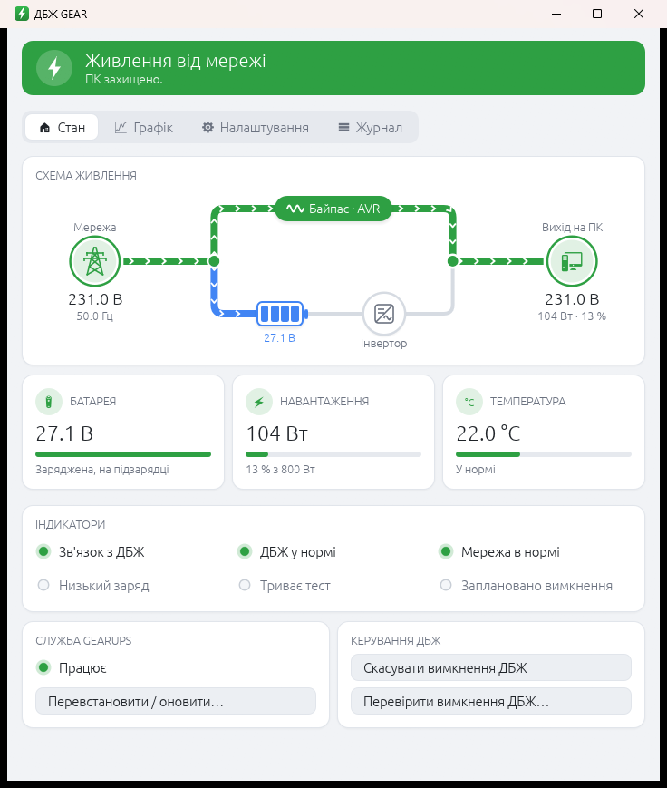

# gear-gu1000ps-monitor

Програма для ДБЖ **GEAR GU-1000PS** (USB `0001:0000`, контролер `MEC0003`) під
Windows: служба, вікно зі значком у треї та CLI, усе українською. Замінює
штатні upsSmartView / upsSmartServer / UPSmart.



## Завантаження

Готові `gear-ups.exe` і `gear-ups-gui.exe` — на сторінці
[Releases](../../releases). Покладіть обидва файли в одну папку, запустіть
`gear-ups-gui.exe` і натисніть «Встановити службу…».

## Що вміє

- **Стан ДБЖ:** напруга входу та виходу, частота, навантаження, напруга батареї,
  температура, прапорці (від батареї, низький заряд, AVR, несправність).
- **Захист ПК:** вимикає ПК, якщо мережі немає довше `on_battery_shutdown_secs`
  (типово 10 хв) або якщо ДБЖ повідомляє про низький заряд.
- **Вимкнення ДБЖ після вимкнення ПК.** Команда надсилається лише тоді, коли
  Windows однозначно вимикається (подія 1074 «Вимкнення живлення» / «Завершити
  роботу»). Під час перезавантаження, сну чи встановлення оновлень ДБЖ лишається
  увімкненим.
  - Якщо мережа є, ДБЖ лишається вимкненим до натискання його кнопки.
  - Якщо ПК вимикався, коли ДБЖ працював від батареї, ДБЖ сам увімкнеться,
    щойно повернеться мережа (`ups_return_when_on_battery`).

- **Звук ДБЖ:** кнопка «Перемкнути звук ДБЖ» на вкладці «Налаштування»; поруч
  показано поточний стан (біт 7 відповіді Q1).

- **Зависання USB-контролера ДБЖ.** Інколи контролер продовжує відповідати,
  але повторює той самий застарілий рядок стану. Якщо рядок не змінюється
  10 хв, служба пише про це в журнал, а програма показує тривогу: від'єднайте
  USB-кабель ДБЖ на 10 секунд і під'єднайте знову.

- **Температура ДБЖ:** якщо датчик ДБЖ досягне порогу (`temp_alarm_c`, типово
  55 °C, 0 — вимкнено), програма попереджає, а служба пише в журнал.

**Кулером керувати не можна.** У протоколі цього ДБЖ немає такої команди:
вентилятором керує прошивка.

## Як це працює

Контролер MEC0003 не використовує HID-звіти. Кожна команда Megatec — це запит
USB string-дескриптора, номер дескриптора задає команду. Відповідь — рядок у
форматі Megatec. Карта індексів узята з NUT (`nutdrv_qx`, субдрайвери
`fabula`/`hunnox`):

| індекс | команда |
|---|---|
| `0x03` | Q1 — стан |
| `0x0c` | I — інформація |
| `0x0d` | F — номінали |
| `0x0a` | C — скасувати вимкнення |
| `0x07` | Q — перемкнути звук |
| `0xf3` | заряд батареї, `BL075` = 75 % (не з NUT; так опитує upsSmartView). Програма показує саме його, оцінка за напругою — лише запасний варіант |
| `0x10`…`0x50` | вимкнення через 0,5…0,9 хв |
| `0x60`…`0xf0` | вимкнення через 1…10 хв |
| `+0x08` до індексу вимкнення | увімкнутися, коли повернеться мережа |

Інші індекси **не можна перебирати навмання**: це дії (звуковий сигнал, тест
батареї, вимкнення).

У Windows такий запит робить стандартний `HidD_GetIndexedString`, тому окремий
драйвер ядра не потрібен.

## Збірка

```
cargo build --release
```

Збираються дві програми: `gear-ups.exe` (служба і CLI) та `gear-ups-gui.exe`
(вікно і значок у треї).

## Встановлення

Запустіть `target\release\gear-ups-gui.exe` і натисніть «Встановити службу…»
(або «Перевстановити / оновити службу…»). Windows попросить права
адміністратора. Те саме з командного рядка адміністратора:

```
target\release\gear-ups.exe install --disable-vendor
```

Встановлення:

- зупиняє і вимикає `upsSmartServer`, бо з ДБЖ може працювати лише одна програма;
- копіює обидві програми в `C:\Program Files\GearUps\`. Повторне встановлення
  оновлює їх, навіть якщо програма в треї запущена;
- реєструє і запускає службу `GearUps` з автозапуском;
- дає користувачам право змінювати `config.toml`, тож налаштування можна
  зберігати з вікна без прав адміністратора;
- додає програму в треї до автозапуску (`HKLM\…\Run\GearUpsGui`, з параметром
  `--tray`: стартує згорнутою в трей).

Файли служби:

- налаштування: `C:\ProgramData\GearUps\config.toml`;
- журнал: `C:\ProgramData\GearUps\gear-ups.log`;
- поточний стан для вікна: `C:\ProgramData\GearUps\status.json`;
- історія показників для графіка: `C:\ProgramData\GearUps\history.csv`
  (рядок на кожне опитування; при 4 МБ файл стає `history.csv.old`,
  тож зберігається приблизно тиждень).

Видалення і повернення штатної програми:

```
gear-ups uninstall
sc config upsSmartServer start= auto && sc start upsSmartServer
```

## Програма в треї

Колір значка показує стан: зелений — живлення від мережі, помаранчевий — від
батареї, червоний — несправність, низький заряд, ДБЖ не підключено або
заплановано вимкнення ДБЖ, сірий — служба не працює. Підказка над значком
коротко описує стан.

У вікні чотири вкладки:

- **Стан**: схема живлення, як в UPSmart: мережа (ЛЕП) → байпас · AVR → ПК,
  а нижче батарея → інвертор. Активний шлях підсвічено й анімовано: зелений —
  від мережі, помаранчевий — від батареї, синій — заряджання батареї. Під
  схемою плитки «Батарея», «Навантаження» (у Вт і %), «Температура» та
  індикатори стану; без мережі банер і плитка «Батарея» показують заряд у % і
  приблизний час роботи від батареї, а банер — ще й скільки часу мережі немає
  і через скільки вимкнеться ПК. Заряд оцінюється за напругою з поправкою на
  навантаження, час — за ємністю батареї (`battery_ah`) і законом Пейкерта,
  тож це орієнтир: стара батарея протримається менше. Нижче — стан служби з кнопками встановлення та
  запуску, «Скасувати вимкнення ДБЖ» і «Перевірити вимкнення ДБЖ…» (з
  підтвердженням).
- **Графік**: вхідна й вихідна напруга, навантаження, напруга батареї, заряд
  батареї (від ДБЖ) і температура ДБЖ за 10 хв, годину, 6 годин, добу або тиждень.
  Під курсором — значення всіх ліній і час; останнє значення підписане в кінці
  лінії. Масштаб підлаштовується під дані, графіки можна переставляти кнопками ⬆⬇.
  Періоди без даних (ПК чи служба вимкнені) лишаються розривами.
- **Налаштування**: усі параметри `config.toml`, зокрема потужність ДБЖ у Вт
  (`ups_power_w`, типово 600): ДБЖ повідомляє навантаження лише у відсотках,
  а вати вікно рахує з цієї потужності. Служба застосовує збережені
  зміни сама, перезапускати її не треба.
- **Журнал**: останні 300 рядків журналу служби.

Кнопка закриття ховає вікно в трей. Повністю вийти можна через меню значка
(«Вийти»). Коли зникає мережа або з'являється несправність, вікно відкривається
саме, на основному моніторі: додатковий, не підключений до ДБЖ, у цей час
гасне.

## Налаштування

Файл `C:\ProgramData\GearUps\config.toml` створюється з типовими значеннями
під час першого запуску служби. Служба перечитує його сама, щойно він
зміниться. Якщо файл зіпсовано, служба працює з типовими значеннями і записує
помилку в журнал.

| параметр | типово | що робить |
|---|---|---|
| `poll_interval_secs` | `5` | як часто опитувати ДБЖ, с (1…60) |
| `on_battery_shutdown_secs` | `600` | вимкнути ПК після стількох секунд без мережі (`0` — ніколи) |
| `shutdown_on_battery_low` | `true` | вимкнути ПК одразу, щойно ДБЖ повідомить про низький заряд |
| `ups_off_on_pc_shutdown` | `true` | вимикати ДБЖ після вимкнення ПК |
| `ups_off_delay_min` | `1.0` | затримка перед вимкненням виходу ДБЖ, хв (0,5…10) |
| `ups_return_when_on_battery` | `true` | якщо ПК вимикався від батареї, ДБЖ увімкнеться сам, коли повернеться мережа |
| `skip_when_update_pending` | `true` | не вимикати ДБЖ, якщо Windows чекає на перезавантаження для встановлення оновлень |
| `ups_power_w` | `600` | активна потужність ДБЖ з етикетки, Вт: з неї вікно рахує навантаження у ватах |
| `battery_ah` | `7` | ємність блоку батареї, А·год: з неї вікно оцінює, на скільки вистачить заряду |

Затримка до 1 хв округлюється до кроку 0,1 хв, а від 1 хв — до цілих хвилин.

## Команди

```
gear-ups status [--watch]               стан ДБЖ (з --watch — щосекунди)
gear-ups info                           номінали та прошивка
gear-ups events                         як розпізнано останні вимкнення Windows
gear-ups ups-off <хв> [--return] --yes  вимкнути вихід ДБЖ через <хв> (0.5…10)
gear-ups cancel                         скасувати заплановане вимкнення ДБЖ
gear-ups install [--disable-vendor]     встановити або оновити (від адміністратора)
gear-ups uninstall                      видалити службу
```

Команди працюють і тоді, коли служба `GearUps` запущена. А от поки працює
`upsSmartServer`, ДБЖ зайнятий: він тримає пристрій ексклюзивно.

## Важливо

- Після вимкнення ДБЖ спочатку вмикайте ДБЖ, потім ПК. Щоб вистачало однієї
  кнопки, увімкніть у BIOS «Restore on AC Power Loss = Power On».
- Якщо увімкнено швидкий запуск Windows (Fast Startup), звичайне «Завершити
  роботу» — це гібридна гібернація. Служба реагує на неї через подію сну, якщо
  за останні 2 хв була подія 1074 «вимкнення» або winlogon щойно запросив
  гібридне вимкнення (подія Kernel-Power 187). Друге потрібне тому, що після
  старту зі швидкого запуску Windows подію 1074 при вимкненні не записує.
  Звичайний сон так не виглядає, тож ДБЖ під час сну лишається увімкненим.
- Якщо служба після старту або виходу зі сну бачить заплановане вимкнення ДБЖ,
  вона його скасовує.

Меню налаштувань самого ДБЖ (вихідна напруга, частота, пороги батареї тощо)
описано в [docs/ups-settings.md](docs/ups-settings.md).

## Ліцензія

[MIT](LICENSE). Карта команд Megatec для MEC0003 — з проєкту
[NUT](https://networkupstools.org/) (`nutdrv_qx`).
